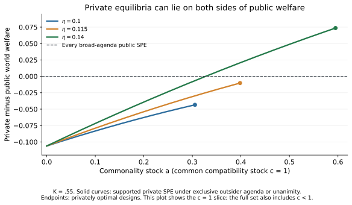

# Stage 30B — 現行モデルだけでfull-paperの核を再検討

著者の追加依頼「フルペーパーにするために今のモデルから導き出せる結果は
できないか？」に対応する。Stage29モデルとStage30監査を保存した研究枝。
原稿は未変更、Stage31投稿準備は停止のまま。

**新たに構成した核候補：全私的均衡の分類、公的均衡の厚生不変性、固定費に
よる私的均衡集合の拡大、選択を固定しない制度厚生の必要十分条件。**

最も強い結果は、広い提案権による公的規格への統一が、全ての旧純粋SPEと
比べて世界厚生を下げない条件を示せることである。閾値より上では、民間の
最悪均衡を改善する一方で最良均衡を失う。これは事前の制度比較であり、
既に投資した企業への強制適合の厚生比較と混同しない。

| ファイル | 内容 |
|---|---|
| [SEARCH_CONTRACT](STAGE30B_SEARCH_CONTRACT.md) | 変更禁止の原始構造、3問、有限の停止点 |
| [RESULTS_AND_PROOFS](STAGE30B_RESULTS_AND_PROOFS.md) | 必要十分条件、全域逸脱、三社排除、厚生上限、失敗した候補 |
| [CONTRIBUTION_REASSESSMENT](STAGE30B_CONTRIBUTION_REASSESSMENT.md) | 何を経済的に学べるか、full-paper再構成案、採録・棄却の理由 |
| [PRIOR_ART_DELTA](STAGE30B_PRIOR_ART_DELTA.md) | 既知の弱いリンク協調・fallback・veto理論への吸収マップ |
| [EXACT_RESULTS](STAGE30B_EXACT_RESULTS.json) | 26厳密符号証明、12,708有理Bernstein係数、境界と反例 |
| [NUMERIC_RESULTS](STAGE30B_NUMERIC_RESULTS.json) | 72私的／24公的プロファイルの有限逸脱探索、数値説明 |
| [FROZEN_INPUTS](STAGE30B_FROZEN_INPUTS.json) | 継承した219ファイルのGit blob hash |



図は完全に証明された`c=1,0<=a<=a_R*`という私的SPEの部分集合を数値描画
する。全均衡の分類や厚生上限の根拠は図ではなく証明文書と厳密計算にある。

## 再現

リポジトリroot、Python3.12：

```bash
python -m pip install -r code/stage30b_requirements.txt
python code/stage30b_within_model_exact.py
python code/stage30b_within_model_numeric.py
python code/stage30b_plot.py
python code/stage30b_evidence_check.py
```

構成証明はStage30の有理Bernstein変換と定数だけを再利用し、新しい対象を
3x3原始需要から再構成する。Stage30で独立に閉じた基準モデルの符号条件は
証明文書に明示的に依存する。開発した同じ査読者による再計算を新Stage4Aの
独立査読と呼ばない。数値探索も全域証明とは呼ばない。

## 判断

**同一モデルのfull-paper再構成を一回検討する価値はある。投稿GOではない。**
min型投資の均衡共存は既知なので、それだけで掲載価値を主張しない。
追加結果を核に選ぶ場合、新Stage4AとStage6に戻って証明・新規性を再審査
する。既存のStage30 NO-GO、七パラメータの未独立検証、Gandal–Shy/Klimenko
掲載版の未解決、費用付き公的規格と自由投票の負の診断はそのまま残る。
新しいモデルを加えて救済する工程は勧告しない。
